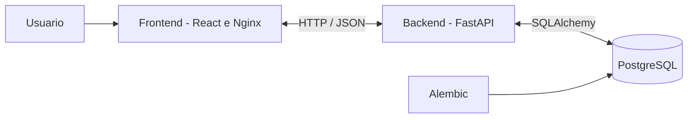
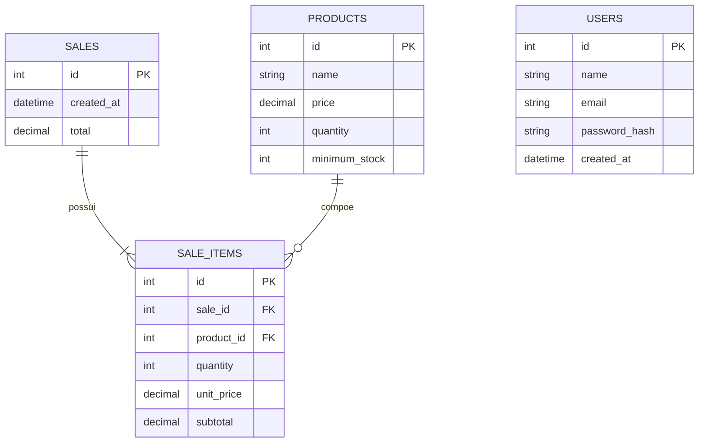

# StockFlow — Sistema de Controle de Estoque e Vendas


## 1. Sobre o projeto

O StockFlow é um sistema web de controle de estoque e vendas,
desenvolvido como projeto final da disciplina de Sistemas
Distribuídos 2 do curso de Engenharia de Software.

O sistema tem como objetivo facilitar o gerenciamento de produtos,
o acompanhamento do estoque e o registro de vendas, permitindo
que pequenos estabelecimentos comerciais tenham maior controle
sobre suas operações.

A aplicação utiliza uma arquitetura distribuída, com frontend,
backend e banco de dados executados em serviços independentes,
integrados por meio de uma API REST e orquestrados pelo Docker Compose.

## 2. Funcionalidades

### Autenticação

- Cadastro de usuários.
- Login com e-mail e senha.
- Autenticação baseada em JWT.
- Armazenamento seguro de senhas por meio de hash.
- Proteção de rotas.
- Logout.

### Gerenciamento de produtos

- Cadastro de produtos.
- Listagem de produtos.
- Pesquisa por nome.
- Edição de produtos.
- Exclusão de produtos.
- Controle de preços e quantidades.
- Definição de estoque mínimo.
- Identificação de produtos com estoque baixo.

### Gerenciamento de vendas

- Seleção de produtos.
- Adição de produtos ao carrinho.
- Controle de quantidades.
- Cálculo automático do valor total.
- Validação da disponibilidade em estoque.
- Registro de vendas.
- Atualização automática do estoque após uma venda.
- Controle transacional das operações de venda.

### Histórico de vendas

- Listagem das vendas realizadas.
- Pesquisa pelo identificador da venda.
- Visualização dos detalhes de cada venda.
- Consulta dos produtos, quantidades e valores registrados.

### Dashboard

- Total de produtos cadastrados.
- Quantidade total de itens em estoque.
- Produtos com estoque baixo.
- Total de vendas realizadas.
- Receita total.
- Receita diária.

## 3. Tecnologias utilizadas

### Backend

| Tecnologia | Finalidade |
| --- | --- |
| Python 3.12 | Linguagem de programação |
| FastAPI | Desenvolvimento da API REST |
| Uvicorn | Servidor da aplicação |
| SQLAlchemy | Mapeamento objeto-relacional |
| Pydantic | Validação de dados |
| Alembic | Versionamento do banco de dados |
| PyJWT | Autenticação por tokens JWT |
| Argon2 | Hash de senhas |
| Poetry | Gerenciamento de dependências |
| Pytest | Testes automatizados |
| Ruff | Análise e formatação de código |

### Frontend

| Tecnologia | Finalidade |
| --- | --- |
| JavaScript | Linguagem de programação |
| React | Desenvolvimento da interface |
| Vite | Ambiente de desenvolvimento e build |
| React Router | Gerenciamento de rotas |
| Lucide React | Ícones da interface |
| CSS | Estilização |
| Vitest | Testes automatizados |
| React Testing Library | Testes de componentes |
| Playwright | Testes de ponta a ponta |
| ESLint | Análise estática de código |
| Biome | Análise e formatação de código |

### Infraestrutura

| Tecnologia | Finalidade |
| --- | --- |
| PostgreSQL 16 | Banco de dados relacional |
| Docker | Containerização dos serviços |
| Docker Compose | Orquestração dos containers |
| Nginx | Servidor web do frontend |
| Git | Controle de versão |
| GitHub Actions | Integração contínua |
| Makefile | Padronização de comandos |

## 4. Arquitetura do sistema

O StockFlow utiliza uma arquitetura cliente-servidor, com
separação entre apresentação, regras de negócio e persistência.



### Frontend

Responsável pela interface gráfica, interação com o usuário,
validação de formulários e comunicação com a API REST.

### Backend

Responsável pelo processamento das requisições, autenticação,
validação dos dados, aplicação das regras de negócio e
comunicação com o banco de dados.

### Banco de dados

Responsável pelo armazenamento persistente dos usuários,
produtos, vendas e itens de venda.

Os serviços são executados em containers independentes e
possuem configurações de comunicação definidas no Docker Compose.

## 5. Organização do projeto

```text
Sistemas-Distribuidos-2/
├── .github/
│   └── workflows/
│       └── ci.yml
├── backend/
│   ├── alembic/
│   │   └── versions/
│   ├── app/
│   │   ├── api/
│   │   ├── database/
│   │   ├── models/
│   │   ├── repositories/
│   │   ├── schemas/
│   │   ├── services/
│   │   └── main.py
│   ├── tests/
│   │   ├── integration/
│   │   └── unit/
│   ├── alembic.ini
│   ├── Dockerfile
│   ├── pyproject.toml
│   └── poetry.lock
├── frontend/
│   ├── e2e/
│   ├── src/
│   │   ├── components/
│   │   ├── contexts/
│   │   ├── layouts/
│   │   ├── pages/
│   │   ├── services/
│   │   ├── tests/
│   │   └── App.jsx
│   ├── biome.json
│   ├── Dockerfile
│   ├── nginx.conf
│   ├── package.json
│   ├── package-lock.json
│   ├── playwright.config.js
│   └── vite.config.js
├── .env.example
├── .gitignore
├── docker-compose.yaml
├── Makefile
└── README.md
```

### Organização do backend

O backend foi dividido em camadas para facilitar a manutenção,
a realização de testes e a separação de responsabilidades.

- **API:** definição das rotas e endpoints.
- **Schemas:** validação dos dados de entrada e saída.
- **Services:** implementação das regras de negócio.
- **Repositories:** operações de acesso ao banco de dados.
- **Models:** representação das entidades persistidas.
- **Database:** configuração da conexão e das sessões.

## 6. Pré-requisitos

Para executar o sistema utilizando Docker:

- Git.
- Docker.
- Docker Compose.

Para desenvolvimento local e execução dos testes:

- Python 3.12.
- Poetry.
- Node.js 22.
- npm.
- GNU Make.

## 7. Instalação e execução

### 7.1. Clonar o repositório

```bash
git clone -b projeto-final https://github.com/luizotavio-amante/Sistemas-Distribuidos-2.git
cd Sistemas-Distribuidos-2
```

### 7.2. Configurar as variáveis de ambiente

Crie um arquivo `.env` na raiz do projeto a partir do
arquivo `.env.example`.

Linux ou Git Bash:

```bash
cp .env.example .env
```

Windows PowerShell:

```powershell
Copy-Item .env.example .env
```

As variáveis disponíveis são:

| Variável | Valor de exemplo |
| --- | --- |
| POSTGRES_USER | stockflow |
| POSTGRES_PASSWORD | stockflow |
| POSTGRES_DB | stockflow |
| POSTGRES_PORT | 5433 |
| JWT_SECRET_KEY | Chave secreta com pelo menos 32 caracteres |
| CORS_ORIGINS | http://localhost:5173,http://127.0.0.1:5173 |
| VITE_API_URL | http://localhost:8000 |

Substitua o valor de `JWT_SECRET_KEY` por uma chave secreta
aleatória antes de iniciar a aplicação.

Caso tenha Python instalado, uma chave pode ser gerada com:

```bash
python -c "import secrets; print(secrets.token_hex(32))"
```

Copie o valor gerado para a variável `JWT_SECRET_KEY` no
arquivo `.env`.

O arquivo `.env` não deve ser versionado, pois pode conter
informações sensíveis.

### 7.3. Iniciar os containers

```bash
docker compose up -d --build
```

Ou utilizando o Makefile:

```bash
make up-build
```

### 7.4. Verificar os serviços

```bash
docker compose ps
```

### 7.5. Acessar o sistema

| Serviço | Endereço |
| --- | --- |
| Frontend | http://localhost:5173 |
| Backend | http://localhost:8000 |
| Swagger UI | http://localhost:8000/docs |
| ReDoc | http://localhost:8000/redoc |
| PostgreSQL | localhost:5433 |

Para utilizar o sistema, acesse o frontend e realize o
cadastro de um usuário na tela de cadastro.

### 7.6. Encerrar os containers

```bash
docker compose down
```

Ou:

```bash
make down
```

Os dados permanecem armazenados no volume do PostgreSQL
mesmo após o encerramento dos containers.

## 8. Banco de dados

O sistema utiliza PostgreSQL como banco de dados relacional,
com SQLAlchemy para o mapeamento das entidades e Alembic
para o gerenciamento das migrations.

### Entidades principais

- **users:** usuários cadastrados.
- **products:** produtos e informações de estoque.
- **sales:** registros de vendas.
- **sale_items:** produtos associados a cada venda.

### Relacionamentos



### Migrations

As migrations são executadas automaticamente durante a
inicialização do container do backend.

Caso seja necessário executá-las manualmente:

```bash
docker compose exec api alembic upgrade head
```

Ou:

```bash
make migrate
```

### Persistência

O PostgreSQL utiliza um volume Docker chamado `stockflow_data`,
permitindo que os dados sejam preservados após reinicializações.

## 9. API REST

A documentação interativa da API é disponibilizada
automaticamente pelo FastAPI através do Swagger UI.

Acesse:

http://localhost:8000/docs

### Autenticação

| Método | Endpoint | Descrição |
| --- | --- | --- |
| POST | /auth/register | Cadastrar usuário |
| POST | /auth/login | Autenticar usuário |
| GET | /auth/me | Consultar usuário autenticado |

### Produtos

| Método | Endpoint | Descrição |
| --- | --- | --- |
| GET | /products | Listar produtos |
| GET | /products/{id} | Consultar produto |
| POST | /products | Cadastrar produto |
| PUT | /products/{id} | Atualizar produto |
| DELETE | /products/{id} | Excluir produto |

### Vendas

| Método | Endpoint | Descrição |
| --- | --- | --- |
| GET | /sales | Listar vendas |
| GET | /sales/{id} | Consultar venda |
| POST | /sales | Registrar venda |

### Dashboard

| Método | Endpoint | Descrição |
| --- | --- | --- |
| GET | /dashboard | Consultar indicadores |

Os endpoints protegidos exigem um token JWT válido,
enviado no cabeçalho da requisição:

```http
Authorization: Bearer <token>
```

## 10. Regras de negócio

O sistema possui validações para garantir a consistência
das operações realizadas.

- Não permite o cadastro de usuários com e-mails duplicados.
- Não permite produtos com preços menores ou iguais a zero.
- Não permite quantidades negativas em estoque.
- Não permite vendas com quantidade superior ao estoque disponível.
- Não permite vendas sem produtos.
- Não permite excluir produtos vinculados a vendas registradas.
- Atualiza automaticamente o estoque após o registro de uma venda.
- Preserva o preço unitário dos produtos no histórico de vendas.
- Utiliza transações para manter a consistência das vendas.
- Utiliza bloqueio de registros durante operações concorrentes
  de venda para evitar a comercialização acima do estoque disponível.

## 11. Testes automatizados

O projeto possui testes unitários, testes de integração,
testes de componentes e testes de ponta a ponta.

| Ferramenta | Tipo | Quantidade |
| --- | --- | ---: |
| Pytest | Backend: unitários e integração | 56 |
| Vitest | Frontend: componentes e serviços | 21 |
| Playwright | Testes de ponta a ponta | 5 |
| **Total** | | **82** |

### 11.1. Instalar as dependências

```bash
make install
```

### 11.2. Preparar o banco de testes

Com os containers em execução, crie um banco de dados
exclusivo para os testes de integração do backend:

```bash
docker compose exec db psql -U stockflow -d stockflow -c "CREATE DATABASE stockflow_test;"
```

Esse comando deve ser executado apenas uma vez, considerando
as credenciais padrão do projeto.

O banco `stockflow_test` é separado do banco principal,
evitando que os testes de integração do backend alterem
os dados utilizados pela aplicação.

### 11.3. Testes do backend

```bash
make test-backend
```

Ou:

```bash
poetry -C backend run python -m pytest tests -v
```

Os testes verificam autenticação, gerenciamento de produtos,
registro de vendas, controle de estoque, operações concorrentes
de venda e indicadores do dashboard.

### 11.4. Testes do frontend

```bash
make test-frontend
```

Ou:

```bash
npm --prefix frontend run test
```

Os testes verificam componentes, formulários, comunicação
com a API, autenticação e comportamento da interface.

### 11.5. Testes de ponta a ponta

Com os containers em execução, instale o navegador utilizado
pelo Playwright:

```bash
cd frontend
npx playwright install chromium
cd ..
```

Execute:

```bash
make test-e2e
```

Os testes E2E verificam:

- Cadastro, login e logout.
- Proteção de rotas.
- Tratamento de credenciais inválidas.
- Cadastro, edição e exclusão de produtos.
- Persistência dos dados após recarregar a página.
- Registro de vendas e atualização do estoque.

Os testes E2E utilizam a aplicação em execução e podem
gerar registros de teste no banco de dados. Portanto,
devem ser executados em um ambiente de desenvolvimento
ou de integração contínua.

### 11.6. Executar todas as validações

Com as dependências instaladas, os containers em execução
e o banco de testes configurado:

```bash
make check-all
```

Esse comando executa as verificações de qualidade,
os testes automatizados e o build do frontend.

## 12. Qualidade de código

O projeto utiliza ferramentas de análise estática e
formatação para manter a padronização do código.

### Backend — Ruff

```bash
make lint-backend
make format-backend
```

### Frontend — ESLint e Biome

```bash
make lint-frontend
make format-frontend
make biome-check
```

### Validação geral

```bash
make lint
```

## 13. Integração contínua

O projeto utiliza GitHub Actions para executar automaticamente
as verificações de qualidade e os testes automatizados.

O workflow está localizado em:

`.github/workflows/ci.yml`

A pipeline é dividida em três jobs independentes.

### Backend

- Configuração do Python e Poetry.
- Inicialização do PostgreSQL de testes.
- Instalação das dependências.
- Análise estática e formatação com Ruff.
- Execução dos testes Pytest.

### Frontend

- Configuração do Node.js.
- Instalação das dependências.
- Validação com ESLint e Biome.
- Execução dos testes Vitest.
- Geração do build de produção.

### E2E

- Inicialização dos serviços com Docker Compose.
- Instalação do Chromium.
- Execução dos testes Playwright.
- Disponibilização do relatório dos testes.
- Encerramento dos containers de teste.

A pipeline é executada em pushes para as branches
`projeto-final` e `main`, em pull requests direcionados
à branch `main` e por acionamento manual.

## 14. Comandos disponíveis

| Comando | Descrição |
| --- | --- |
| make help | Exibe os comandos disponíveis |
| make install | Instala as dependências |
| make up | Inicia os containers |
| make up-build | Reconstrói e inicia os containers |
| make down | Encerra os containers |
| make restart | Reinicia os containers |
| make build | Constrói as imagens Docker |
| make ps | Exibe o estado dos containers |
| make logs | Exibe os logs do sistema |
| make logs-api | Exibe os logs do backend |
| make logs-frontend | Exibe os logs do frontend |
| make migrate | Executa as migrations |
| make test | Executa os testes do backend e frontend |
| make test-backend | Executa os testes do backend |
| make test-frontend | Executa os testes do frontend |
| make test-e2e | Executa os testes Playwright |
| make lint | Valida o código do projeto |
| make lint-backend | Valida o código do backend |
| make lint-frontend | Valida o código do frontend |
| make format-backend | Formata o código do backend |
| make format-frontend | Formata o código do frontend |
| make biome-check | Valida o frontend com Biome |
| make build-frontend | Gera o build do frontend |
| make check-all | Executa todas as validações |

## 15. Conceitos de sistemas distribuídos aplicados

Durante o desenvolvimento do StockFlow, foram aplicados
conceitos estudados na disciplina de Sistemas Distribuídos 2:

- Arquitetura cliente-servidor.
- Comunicação entre serviços por HTTP.
- Separação de responsabilidades.
- Interfaces de comunicação padronizadas por API REST.
- Persistência de dados.
- Controle de concorrência.
- Containerização de aplicações.
- Orquestração de serviços.
- Configuração de serviços por variáveis de ambiente.
- Testes de integração entre componentes.
- Automação de processos de integração contínua.

## 16. Escopo e limitações

O StockFlow foi desenvolvido para fins acadêmicos e possui
um ambiente compartilhado de gerenciamento de estoque e vendas.

Os usuários autenticados possuem acesso às mesmas
funcionalidades e aos mesmos dados do sistema.

A aplicação não possui diferenciação de permissões por perfil,
recuperação de senha ou isolamento de dados por estabelecimento.

As configurações disponibilizadas são destinadas à execução
local e à demonstração acadêmica. Uma implantação em produção
exigiria configurações adicionais de segurança e infraestrutura.

## 17. Informações acadêmicas

- **Projeto:** StockFlow — Sistema de Controle de Estoque e Vendas.
- **Disciplina:** Sistemas Distribuídos 2.
- **Curso:** Engenharia de Software.
- **Instituição:** Instituto Nacional de Telecomunicações — Inatel.
- **Autor:** Luiz Otavio Sales.
- **Ano:** 2026.

---

Projeto desenvolvido para aplicação prática dos conhecimentos
adquiridos na disciplina de Sistemas Distribuídos 2.
